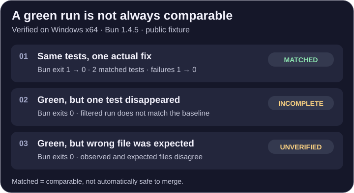
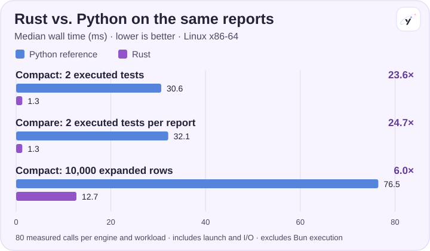

  

<h1 align="center">Yomumi Harness</h1>

<strong>Know what actually changed in your Bun tests.</strong>

  <a href="#results-at-a-glance">Results</a> ·
  <a href="#quick-start">Quick start</a> ·
  <a href="docs/guide/README.md">Field guide</a> ·
  <a href="AGENT-START.md">Agent entry point</a>

Bun tells you whether a command passed. Yomumi Harness helps you check **which files ran** and **whether a before/after pair ran the same observed tests**. It emits small JSON for reviewers and agents, without uploading the original report.

## Results at a glance

| Question | What we observed | Where to verify |
| --- | --- | --- |
| **Faster to process?** | **30.644 → 1.301 ms** median to compact a real Bun report, about **23.6×** vs. our Python reference. | [Linux data](docs/evidence/linux-latency.csv) · [Speed and methodology](#measured-speed) |
| **Same behavior?** | **284/284** Rust/Python comparisons matched in parsed JSON and exit code on the Linux test suite. | [Parity runner](parity.py) · [Evidence ledger](docs/guide/03-measurement.md#evidence-ledger) |
| **Does it catch false green?** | On Windows, a filtered Bun run exited **0**, but Harness returned **`incomplete`** because it ran fewer tests. | [Windows replay](docs/evidence/guide-replay-windows.json) · [Repeat the case](docs/guide/01-first-run.md#case-2-a-green-run-that-ran-less) |
| **Smaller handoff?** | **880 → 513 bytes** on one fixture (**41.7%** smaller). This is not a token measurement. | [Windows smoke output](docs/evidence/windows-smoke.json) |

### What the tool catches

The [walkthrough](docs/guide/01-first-run.md) reproduces all three cases in Bash or PowerShell. The passing filtered run still covers the same **file**, which is why the two-run **test identity** check matters.

### Measured speed

| Workload | Python p50 / p95 | Rust p50 / p95 | Median ratio |
| --- | ---: | ---: | ---: |
| Compact actual Bun report (2 tests) | 30.644 / 36.601 ms | 1.301 / 1.626 ms | 23.6× |
| Compare actual Bun reports (2 tests each) | 32.114 / 41.805 ms | 1.302 / 1.623 ms | 24.7× |
| Compact expanded fixture (10,000 rows) | 76.475 / 105.210 ms | 12.732 / 16.563 ms | 6.0× |

Same Linux x86-64 host and inputs, Python 3.12 and Rust 1.100.0 release build, Bun 1.4.5. **80 measured calls per engine per workload** after five warm-up pairs, alternating order. Timings include startup and file I/O, not Bun execution. The 10,000 rows were expanded from Bun output, not 10,000 executed tests. Windows was checked for behavior only. [Reproduction steps and limits](docs/guide/03-measurement.md).

See the size comparison

The sample is a public fixture, not production evidence. Summary output can still contain file paths and deterministic hashes.

## Quick start

**1. Build and run the sample** from this checkout. The demo driver uses Python 3.10+ and Bun; the compiled Rust CLI needs neither to read existing reports.

~~~sh
cargo build --release --locked
python example_smoke.py
~~~

Expect two matched tests, one fix, and `unverified` for the wrong expected file. The binary is `target/release/yomumi-evidence` (add `.exe` on Windows).

**2. Check a real project run.** Run Bun from your project root and record its actual exit before another command overwrites it:

~~~sh
bun_rc=0
bun test ./tests/example.test.ts --reporter=junit --reporter-outfile=run.xml || bun_rc=$?
/path/to/yomumi-harness/target/release/yomumi-evidence compact run.xml \
  --bun-exit "$bun_rc" --expect-file tests/example.test.ts
~~~

In PowerShell capture `$LASTEXITCODE` immediately after Bun. Repeat `--expect-file` for each intended file. `0` = scoped pass, `1` = scoped failure, `2` = unverified or invalid. Without scope arguments, the command only summarizes.

**3. Compare two runs on the same selection.** These example codes are for a failing baseline and passing candidate. Use the codes you actually captured.

~~~sh
target/release/yomumi-evidence compare before.xml after.xml --before-exit 1 --after-exit 0
~~~

`matched` means comparable, **not** passed or safe to merge. Read the change labels. See [all exit codes and troubleshooting](docs/guide/04-reference.md).

## Choose your workflow

| I want to… | Go here |
| --- | --- |
| Run the three real sample cases | [First run](docs/guide/01-first-run.md) |
| Review a patch or hand evidence to an agent | [Review recipes and copyable prompts](docs/guide/02-review-recipes.md) |
| Reproduce a number or check its limitations | [Measurement and evidence ledger](docs/guide/03-measurement.md) |
| Fix an unverified result without hiding the problem | [Reference and recovery](docs/guide/04-reference.md) |
| Change the CLI or add a fixture | [Contributor checklist](CONTRIBUTING.md) |

## What we built and why

- **`compact`** groups failures and checks counts, file scope, and Bun’s exit. It does not turn an unscoped report into a pass.
- **`compare`** checks observed test identities and execution counts before describing fixes, regressions, and changed failures. This is the layer that catches the filtered-run case.
- **Rust** is the default executable. The Python implementation remains the reference and explicit fallback (`python example_smoke.py --engine python`). No silent fallback on failed or unverified work.

### How it compares

| If you need… | Use… |
| --- | --- |
| A full machine-readable report from the runner | [Bun JUnit](https://bun.sh/docs/test/reporters), which generates our input. |
| PR annotations and GitHub job summaries | [action-junit-report](https://github.com/mikepenz/action-junit-report) or [dorny/test-reporter](https://github.com/dorny/test-reporter). |
| Playbooks for an agent’s full engineering workflow | [poteto’s pstack](https://github.com/cursor/plugins/tree/main/pstack). |
| Local scope verification and a compact matched-run delta | **Yomumi Harness**, alongside the runner and CI reporter. |

These are role comparisons, not head-to-head speed rankings. The [pstack guide](https://github.com/cursor/plugins/tree/main/pstack/docs/guide) inspired the short entry point and task-based guides. No pstack skills or code are bundled. The Rust CLI uses [roxmltree](https://github.com/RazrFalcon/roxmltree) for XML, [serde_json](https://github.com/serde-rs/json) for JSON, and [RustCrypto SHA-2](https://github.com/RustCrypto/hashes/tree/master/sha2) for fingerprints. See [Cargo.lock](Cargo.lock).

### Scope and privacy

This is a shareable part of Yomumi, not the product or its internal tool registry. Public cases use the [order and cart fixture](examples/fixture.test.ts), not customer data or production reports. Keep raw reports, revisions, and runner settings local. Summaries omit raw assertion text and logs, but paths and hashes can still be sensitive. The CLI caps each report at 8 MiB and cannot independently establish that two reports came from the same code or environment. [MIT license](LICENSE).
