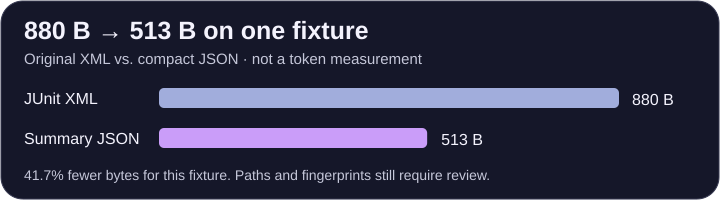
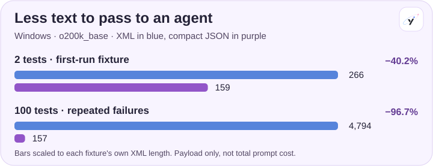

  

<h1 align="center">Yomumi Harness · Bun JUnit Test Harness</h1>

<strong>Compare Bun test runs without mistaking missing tests for fixes.</strong>

Local CLI · Rust · Bun JUnit · <a href="LICENSE">MIT</a>

  <a href="#try-it">Try it</a> ·
  <a href="#results-at-a-glance">Results</a> ·
  <a href="#install">Install</a> ·
  <a href="#use-it-in-your-project">Use in a project</a> ·
  <a href="docs/guide/README.md">Field guide</a> ·
  <a href="AGENT-START.md">Agent entry point</a>

Yomumi Harness is an open-source test harness for comparing Bun JUnit XML reports and delivering compact test evidence to developers and coding agents. Bun answers **“Did this command pass?”** Yomumi Harness adds **“Did we run the intended files, and are the before and after results comparable?”** It keeps the original JUnit report local and hands reviewers or agents a compact JSON result.

## Try it

With [Rust](https://www.rust-lang.org/tools/install) available, run from the checkout. This uses two checked-in reports captured from the public Bun fixture. **No Bun or Python required for the replay.**

~~~sh
git clone https://github.com/Lumichandesu/yomumi-harness.git
cd yomumi-harness
cargo run --release --locked -- compare examples/replay/before.xml examples/replay/after.xml --before-exit 1 --after-exit 0
~~~

Expect `matched`, two tests, and one `fixed` change. [Replay all three saved reports](examples/replay/README.md), or [generate fresh reports with Bun](docs/guide/01-first-run.md) to reproduce the original workflow. Cargo may fetch dependencies on the first build.

## Results at a glance

| Question | What we observed | Where to verify |
| --- | --- | --- |
| **Faster to process?** | **30.644 → 1.301 ms** median to compact a real Bun report, about **23.6×** vs. our Python reference. | [Linux data](docs/evidence/linux-latency.csv) · [Speed and methodology](#measured-speed) |
| **Same behavior?** | **284/284** Rust/Python comparisons matched in parsed JSON and exit code on the Linux test suite. | [Parity runner](parity.py) · [Evidence ledger](docs/guide/03-measurement.md#evidence-ledger) |
| **Does it catch false green?** | On Windows, a filtered Bun run exited **0**, but Harness returned **`incomplete`** because one of the two tests was skipped. | [Windows replay](docs/evidence/guide-replay-windows.json) · [Repeat the case](docs/guide/01-first-run.md#case-2-a-green-run-that-ran-less) |
| **Fewer payload tokens?** | **266 → 159** on the first-run fixture; **4,794 → 157** on the repeated-failure fixture. | [Token method and replay](docs/guide/05-token-budget.md) |
| **Fewer bytes?** | **880 → 513 bytes** on one fixture (**41.7%** smaller). This is not a token measurement. | [Windows smoke output](docs/evidence/windows-smoke.json) |

### What the tool catches

The [walkthrough](docs/guide/01-first-run.md) reproduces all three cases in Bash or PowerShell. The passing filtered run still names the same **file**, but Bun records one skipped test. Exact test identity and skip checks prevent a narrower run from looking like a fix.

### Same number of failures, new bug

One failure before, one failure after. The total didn't move, but the order test was fixed and the cart test broke. Harness reports **one fix and one regression**. If the same test still fails with a different assertion result, it reports **`changed_failure`**, not a fix. [Try both cases](docs/guide/09-equal-counts.md) · [Actual output](docs/evidence/equal-count-windows.json).

### Measured speed

| Workload | Python p50 / p95 | Rust p50 / p95 | Median ratio |
| --- | ---: | ---: | ---: |
| Compact actual Bun report (2 tests) | 30.644 / 36.601 ms | 1.301 / 1.626 ms | 23.6× |
| Compare actual Bun reports (2 tests each) | 32.114 / 41.805 ms | 1.302 / 1.623 ms | 24.7× |
| Compact expanded fixture (10,000 rows) | 76.475 / 105.210 ms | 12.732 / 16.563 ms | 6.0× |

Same Linux x86-64 host and inputs, Python 3.12 and Rust 1.100.0 release build, Bun 1.4.5. **80 measured calls per engine per workload** after five warm-up pairs, alternating order. Timings include startup and file I/O, not Bun execution. The 10,000 rows were expanded from Bun output, not 10,000 executed tests. Windows was checked for behavior only. [Reproduction steps and limits](docs/guide/03-measurement.md).

See the size comparison

The sample is a public fixture, not production evidence. Summary output can still contain file paths and deterministic hashes.

### Why this uses fewer tokens

The point is to let an agent decide whether a run is trustworthy and where to look first **without reading every stack trace or passing row**. Keep the full report for targeted follow-up. This measures only the text passed as evidence with `o200k_base`, not total prompts, cost, or model quality. [See the measurements and reproduce them](docs/guide/05-token-budget.md).

## Install

Use the release binary built by `cargo build --release --locked`: `target/release/yomumi-evidence` (`.exe` on Windows). Or install from a checked-out copy:

~~~sh
cargo install --path . --locked
~~~

This is a source install, not a registry or package-manager release. Cargo may download the locked dependencies when building for the first time. The installed CLI runs offline and does not require Python or Bun to read an existing report. [Windows source-install smoke](docs/evidence/installed-cli-windows.json).

Run `yomumi-evidence --help`, `yomumi-evidence compact --help`, or `yomumi-evidence compare --help` for built-in command and exit-code help.

## Use it in your project

| Start with… | Run… | Get… |
| --- | --- | --- |
| One Bun report and expected test files | `compact` | A scoped verdict and top failure clusters. |
| Two reports from the same selection | `compare` | A before/after delta or a clear stop when the results cannot be compared. |
| A matched delta, but a team-specific rule | [Local review example](docs/guide/08-integrate.md) | An explicit decision without changing the runner or auto-merging a branch. |

**Check a real project run.** Run Bun from your project root and record its actual exit before another command overwrites it:

~~~sh
bun_rc=0
bun test ./tests/example.test.ts --reporter=junit --reporter-outfile=run.xml || bun_rc=$?
/path/to/yomumi-harness/target/release/yomumi-evidence compact run.xml \
  --bun-exit "$bun_rc" --expect-file tests/example.test.ts
~~~

In PowerShell capture `$LASTEXITCODE` immediately after Bun. Repeat `--expect-file` for each intended file. `0` = scoped pass, `1` = scoped failure, `2` = unverified or invalid. Without scope arguments, the command only summarizes.

**Compare two runs on the same selection.** These example codes are for a failing baseline and passing candidate. Use the codes you actually captured.

~~~sh
target/release/yomumi-evidence compare before.xml after.xml --before-exit 1 --after-exit 0
~~~

`matched` means comparable, **not** passed or safe to merge. Read the change labels. See [all exit codes and troubleshooting](docs/guide/04-reference.md).

When a comparison is incomplete, use `yomumi-evidence compare --diagnostics BEFORE AFTER --before-exit EXIT --after-exit EXIT` for a stable reason such as `after_skipped_tests`. The flag does not change verdicts, exit codes, or successful output.

For a compact review that still counts every fix, regression, and changed failure, use Rust `compare --summary-only`. See the [15-test case where a regression fell outside the default list](docs/guide/10-bounded-summaries.md).

[Changelog](CHANGELOG.md) · [Report format and retry limitations](docs/guide/04-reference.md#retries)

## Choose your workflow

| I want to… | Go here |
| --- | --- |
| Run the original three real sample cases | [First run](docs/guide/01-first-run.md) |
| Review a patch or hand evidence to an agent | [Review recipes and copyable prompts](docs/guide/02-review-recipes.md) |
| Reproduce a number or check its limitations | [Measurement and evidence ledger](docs/guide/03-measurement.md) |
| Fix an unverified result without hiding the problem | [Reference and recovery](docs/guide/04-reference.md) |
| See exactly what each test layer proves | [Verification guide](docs/guide/07-verification.md) |
| Wire the JSON into an existing review script | [Integration recipes](docs/guide/08-integrate.md) |
| Fork for a monorepo, a review gate, or a different runner | [Fork and adapt](docs/guide/06-fork-and-adapt.md) |
| Change the CLI or add a fixture | [Contributor checklist](CONTRIBUTING.md) |

### When not to use it

- Need line annotations in GitHub or a team dashboard? Use a CI reporter. This tool emits JSON; it does not publish checks.
- Need full code coverage, arbitrary JUnit support, or an automatic ship decision? This tool only verifies evidence for the observed Bun run. [Fork guide](docs/guide/06-fork-and-adapt.md) explains how to add a runner without relaxing the checks.
- Need the complete failure details? Keep the raw report and inspect the relevant part locally. The compact summary is a first pass, not a replacement for the original.

## Who benefits

- **Bun developers** get a scoped report for a focused test run and a compact diff for the same suite before and after a change.
- **AI-assisted reviewers** can send small, structured evidence first and pull the full details only when necessary.
- **Tool builders** can fork the parser and verdict policy, or add an adapter for another runner. [What to keep, change, and test in a fork](docs/guide/06-fork-and-adapt.md).

## What we built and why

- **`compact`** groups failures and checks counts, file scope, and Bun’s exit. It does not turn an unscoped report into a pass.
- **`compare`** checks observed test identities and execution counts before describing fixes, regressions, and changed failures. This is the layer that catches the filtered-run case.
- **Rust** is the default executable. The Python implementation remains the reference and explicit fallback (`python example_smoke.py --engine python`). No silent fallback on failed or unverified work.

### How it compares

| If you need… | Use… |
| --- | --- |
| A full machine-readable report from the runner | [Bun JUnit](https://bun.sh/docs/test/reporters), which generates our input. |
| PR annotations and GitHub job summaries | [action-junit-report](https://github.com/mikepenz/action-junit-report) or [dorny/test-reporter](https://github.com/dorny/test-reporter). |
| Playbooks for an agent’s full engineering workflow | [poteto’s pstack](https://github.com/cursor/plugins/tree/main/pstack). |
| Local scope verification and a compact matched-run delta | **Yomumi Harness**, alongside the runner and CI reporter. |

These are role comparisons, not head-to-head speed rankings. The [pstack guide](https://github.com/cursor/plugins/tree/main/pstack/docs/guide) inspired the short entry point and task-based guides. No pstack skills or code are bundled. The Rust CLI uses [roxmltree](https://github.com/RazrFalcon/roxmltree) for XML, [serde_json](https://github.com/serde-rs/json) for JSON, and [RustCrypto SHA-2](https://github.com/RustCrypto/hashes/tree/master/sha2) for fingerprints. See [Cargo.lock](Cargo.lock).

### Contribute

The best first contribution is a **small public-safe case the current tool handles poorly**, with the Bun command, observed verdict, and expected verdict. Try the [contributor checklist](CONTRIBUTING.md) and [verification guide](docs/guide/07-verification.md) before changing the parser. [Open a GitHub issue](https://github.com/Lumichandesu/yomumi-harness/issues/new) if you can share a minimal fixture. Keep private logs and credentials out of issues.

### Scope and privacy

This is a shareable part of Yomumi, not the product or its internal tool registry. Public cases use the [order and cart fixture](examples/fixture.test.ts), not customer data or production reports. Keep raw reports, revisions, and runner settings local. Summaries omit raw assertion text and logs, but paths and hashes can still be sensitive. The CLI caps each report at 8 MiB and cannot independently establish that two reports came from the same code or environment. [MIT license](LICENSE).
